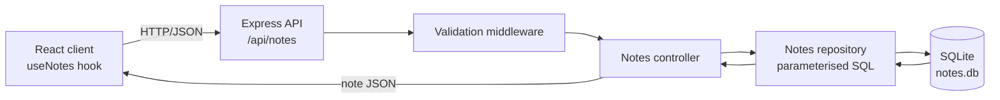
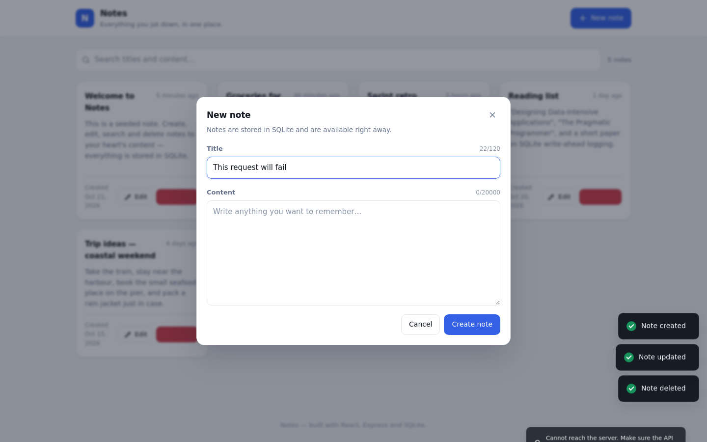
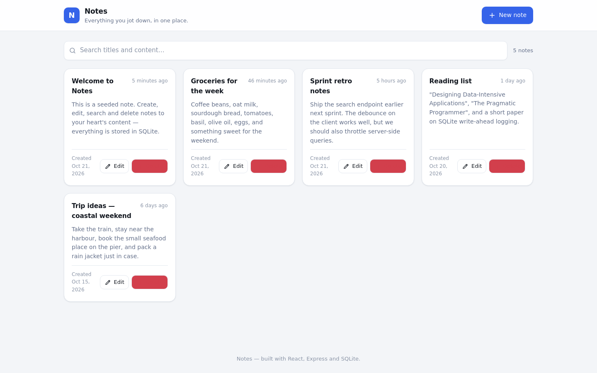
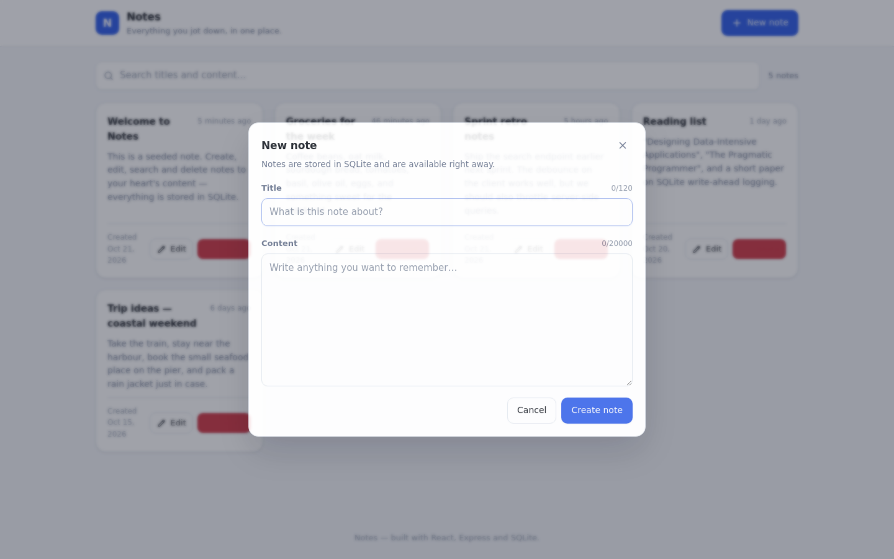
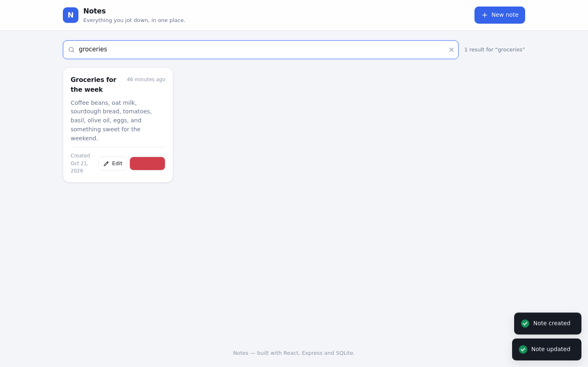
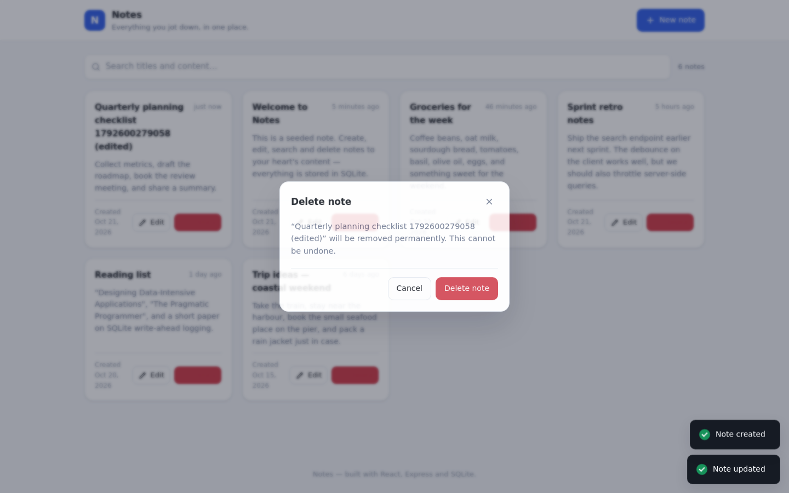
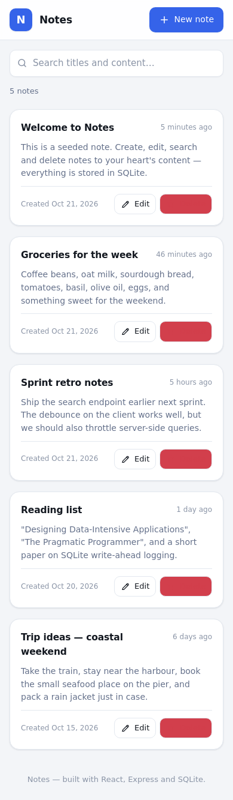

# Notes

A small full-stack notes app: create, browse, search, edit and delete notes, with
everything persisted in SQLite. It was built as an internship project to practise
shipping a real product end to end — API design, validation, error handling, a
responsive UI and honest documentation.


## Features

- Create, view, edit and delete notes (title + content with created/updated timestamps)
- Full-note view modal with created and last-updated timestamps
- Instant search across titles and content, debounced by 300 ms and matched
  server-side with a parameterised SQL `LIKE`
- Search results highlight matches, show "X of Y notes" and include a clear (×) button
- Responsive card grid: 4 → 3 → 2 → 1 columns across breakpoints, plus a grid/list toggle
- Title is required and capped at 100 characters; content is required; the form shows
  inline errors, character counters and a disabled submit button while saving
- Optimistic create/update/delete with rollback, followed by reconciliation from the
  server response so client state always mirrors the database
- Toast notifications for every success and every failure (network, 4xx, 5xx)
- Loading skeletons, an empty state and a dedicated "no results" state
- Trash icon + "Delete" label and a confirmation modal before anything is removed
- Parameterised SQL, input validation, centralised error handling, CORS, environment
  configuration through `.env`

## Tech stack

| Layer     | Choice                                              |
| --------- | --------------------------------------------------- |
| Frontend  | React 18 + Vite, plain CSS, `react-hot-toast`        |
| Backend   | Node.js + Express 4, ES modules                     |
| Database  | SQLite through `better-sqlite3` (synchronous driver) |
| HTTP      | `fetch` wrapped in a small API client                |
| Dev tools | `concurrently` to run client and server together     |

No UI framework, no ORM and no state-management library — the app is small enough that
React hooks and a single `useNotes` hook are all it needs.

## Architecture

The client never talks to the database. It talks to a REST API, the API talks to SQLite,
and every response the API returns is the source of truth for the UI.



A closer look at the request path for a single note:

```
GET /api/notes?search=harbour
  │
  ├─ notes.routes.js     matches the route, attaches the parsed id
  ├─ validateNote.js     checks the payload before it reaches a controller
  ├─ notes.controller.js shapes the response ({ notes, count })
  └─ notesRepository.js  runs a parameterised LIKE query and maps rows to notes
```

On the client the same flow is mirrored by `useNotes`:

```
SearchBar ──(300 ms debounce)──> useNotes ──> notesApi.list() ──> fetch
                                                              │
                              setNotes(server response) <─────┘
```

### Folder layout

```
notes-app/
├── client/
│   ├── src/
│   │   ├── services/     central API client and typed error handler
│   │   ├── components/   presentational building blocks
│   │   ├── hooks/        useDebounce, useNotes
│   │   ├── styles/       design tokens and stylesheets
│   │   ├── utils/        date formatting helpers
│   │   ├── App.jsx
│   │   └── main.jsx
│   ├── .env.example
│   ├── package.json
│   └── vite.config.js
├── server/
│   ├── src/
│   │   ├── config/       environment configuration
│   │   ├── routes/       route definitions
│   │   ├── controllers/  request → response
│   │   ├── middleware/   validation, CORS, logging, error handling
│   │   ├── db/           connection, repository and scripts
│   │   │   ├── schema.sql
│   │   │   └── seed.js
│   │   ├── app.js
│   │   └── server.js
│   ├── .env.example
│   └── package.json
├── screenshots/
├── .gitignore
├── package.json
└── README.md
```

## Prerequisites

- Node.js 18.18 or newer (developed on Node 22)
- npm 9 or newer
- A C toolchain is only needed if `better-sqlite3` has to compile from source; the
  prebuilt binary is used on most platforms

## Setup

```bash
git clone <your-fork-url> notes-app
cd notes-app

npm install                 # root tooling (concurrently)
npm --prefix server install
npm --prefix client install
```

Configuration lives in `.env` files that are **not** committed. Copy the examples and
adjust them if the defaults do not fit your setup:

```bash
cp server/.env.example server/.env
cp client/.env.example client/.env
```

| Variable              | Where         | Default                  | Purpose                                     |
| --------------------- | ------------- | ------------------------ | ------------------------------------------- |
| `PORT`                | server        | `4000`                   | Port the API listens on                     |
| `NODE_ENV`            | server        | `development`            | `production` enables stricter CORS and hides error internals |
| `CLIENT_ORIGIN`       | server        | `http://localhost:5173` | Comma-separated list of allowed browser origins |
| `DATABASE_FILE`       | server        | `data/notes.db`          | SQLite file, relative to `server/`          |
| `VITE_API_URL`        | client        | `http://localhost:4000/api` | Base URL of the API                      |

Create the database and start both applications:

```bash
npm run db:init     # creates the tables described in server/src/db/schema.sql
npm run db:seed     # optional: inserts five sample notes
npm run dev         # API on :4000, client on :5173
```

Open <http://localhost:5173> in a browser. The Vite dev server and the API run side by
side; the client talks to the API over CORS.

### Other scripts

| Command            | Description                                        |
| ------------------ | -------------------------------------------------- |
| `npm run dev`      | Runs the API and the Vite dev server together      |
| `npm run dev:server` | Runs only the API (with `node --watch`)          |
| `npm run dev:client` | Runs only the client                            |
| `npm run build`    | Builds the production client into `client/dist`    |
| `npm start`        | Starts the API alone (set `NODE_ENV=production` in `server/.env`) |
| `npm run db:init`  | Creates the schema                                  |
| `npm run db:seed`  | Inserts sample notes (`-- --force` to add them again) |
| `npm run db:reset` | Deletes the database file so it can be recreated   |

When `client/dist` exists the API also serves the built client, so a single
`npm run build && npm start` gives you the whole app on <http://localhost:4000>.

## API

All endpoints live under `/api` and answer with JSON. Errors always use the same
shape:

```json
{ "error": "Title is required" }
```

| Method   | Endpoint         | Description                                        | Request                                        | Response                                   |
| -------- | ---------------- | -------------------------------------------------- | ---------------------------------------------- | ------------------------------------------ |
| `GET`    | `/api/notes`     | Lists notes, newest update first                   | `?search=term` (optional)                       | `200` `{ "notes": [...], "count": 2, "total": 5 }` |
| `GET`    | `/api/notes/:id` | Returns a single note                              | —                                                | `200` `{ "note": {...} }`                   |
| `POST`   | `/api/notes`     | Creates a note                                     | `{ "title": "Title", "content": "Body" }`        | `201` `{ "note": {...} }`                   |
| `PUT`    | `/api/notes/:id` | Replaces title and content of a note               | `{ "title": "Title", "content": "Body" }`        | `200` `{ "note": {...} }`                   |
| `DELETE` | `/api/notes/:id` | Deletes a note                                     | —                                                | `204` no content                            |
| `GET`    | `/api/health`    | Liveness probe and note count                      | —                                                | `200` `{ "status": "ok", "notes": 5 }`      |

A note looks like this:

```json
{
  "id": 1,
  "title": "Groceries for the week",
  "content": "Coffee beans, oat milk, sourdough bread…",
  "createdAt": "2026-01-08T09:12:44.120Z",
  "updatedAt": "2026-01-08T09:12:44.120Z"
}
```

### Example session

```bash
curl -s http://localhost:4000/api/notes | jq

curl -s -X POST http://localhost:4000/api/notes \
  -H 'Content-Type: application/json' \
  -d '{"title":"Release checklist","content":"Tag, push, deploy."}' | jq

curl -s "http://localhost:4000/api/notes?search=release" | jq

curl -s -X PUT http://localhost:4000/api/notes/6 \
  -H 'Content-Type: application/json' \
  -d '{"title":"Release checklist v2","content":"Tag, push, deploy, verify."}' | jq

curl -s -X DELETE -i http://localhost:4000/api/notes/6
```

### Status codes

| Code | When                                                                   |
| ---- | ---------------------------------------------------------------------- |
| 200  | Successful read or update                                              |
| 201  | Note created                                                           |
| 204  | Note deleted (no response body)                                        |
| 400  | Validation failed (missing title, title too long, invalid id, bad JSON) |
| 403  | Origin rejected by the CORS policy                                      |
| 404  | Note or route does not exist                                            |
| 500  | Unexpected server error                                                 |

## Error handling

The API funnels every failure through one middleware (`server/src/middleware/errorHandler.js`).
Known problems carry a status code and a human-readable message; anything unexpected is
logged on the server and answered with a generic 500 so internals never leak to the
browser. The client reads the `error` field and shows it in a toast, so the same
message is used everywhere:

- **Network failures** — the `fetch` wrapper catches transport errors and reports
  "Cannot reach the server. Make sure the API is running." instead of a raw `TypeError`.
- **Server errors** — a 4xx/5xx response keeps the message sent by the API
  ("Title is required", "Note 42 was not found", …).
- **Timeouts** — requests are aborted after 10 seconds and reported as a timeout.
- **Client-side validation** — the form checks that the title (≤ 100 characters) and
  content are present before sending, so obvious mistakes never reach the network.
  The server validates again anyway.

The UI never crashes on a failed request: a failed initial load renders a retry panel,
a failed refresh keeps the current notes on screen and adds a banner, and failed
mutations leave the dialog open with the typed text intact.



## Screenshots

> These are placeholder sections. Replace each image with a fresh capture of the
> running app (1440×900 for desktop, 390×844 for mobile) before publishing.

### Home



### Create modal



### Edit modal


### Search results



### Delete confirmation



### Error toast


### Mobile view



## Possible future improvements

- Pagination and sorting options for very large collections
- Rich text editing or Markdown rendering for note content
- Labels, folders and a dark-mode toggle stored per user
- Real authentication and per-user notes
- An audit log of note edits
- Server-side pagination with an infinite-scrolling grid
- Automated tests around the repository and the API routes
